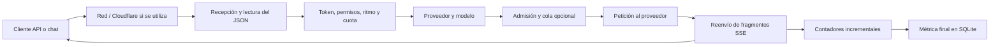

# Flujo y rendimiento del proxy de benzIA

Revisión del 13 de octubre de 2026. Alcance: API compatible con OpenAI, catálogo de modelos, streaming y contabilidad. Los cambios están en el código local y requieren recargar el proceso Node para entrar en servicio.

Actualización posterior: la [auditoría de caché KV](kv-cache-audit.md) recoge la verificación funcional solicitada, con 106 pruebas correctas y contraste con los logs de NInfer. Las limitaciones de pruebas indicadas al final de este análisis corresponden a la revisión inicial.

## Recorrido de una petición

La ruta de inferencia no consulta `/v1/models`. Las consultas de catálogo pertenecen al arranque/actualización del cliente. La rama sin streaming recibe el cuerpo completo para enviarlo y obtener sus contadores de uso.

## Evidencia disponible

Se consultaron en modo de solo lectura las últimas 1.000 métricas existentes, entre el 13/10/2026 a las 06:54:14 y las 19:11:15 UTC:

| Ruta | Peticiones | HTTP 200 | HTTP 400 | Cancelaciones 499 | Mediana al primer token en respuestas correctas |
| --- | ---: | ---: | ---: | ---: | ---: |
| `/v1/chat/completions` | 939 | 932 | 2 | 5 | 829 ms |
| `/v1/responses` | 61 | 18 | 38 | 5 | 2.107 ms |

Son cargas distintas: estas cifras no demuestran que un protocolo sea más rápido. Las métricas no guardan los cuerpos de error y no permiten atribuir esos 400 a una causa concreta. El chat puede reintentar un 400 de Responses usando Chat Completions, por lo que esos intentos son una posible fuente de latencia que debe distinguirse del tiempo de generación.

Ninguna respuesta correcta de esa muestra tiene `throughputSource: upstream`; las velocidades son estimadas. Las métricas antiguas tampoco separan preparación, cola y espera del proveedor, ni contienen mediciones de llegada a un cliente remoto. No permiten cuantificar el coste de Cloudflare ni una mejora porcentual de esta revisión.

## Cambios aplicados

| Coste encontrado | Cambio | Efecto esperado |
| --- | --- | --- |
| Dos copias profundas del cuerpo antes de la petición | Copias superficiales de campos que se modifican; mensajes, herramientas y adjuntos se comparten como datos de solo lectura | Menos asignaciones con historiales grandes |
| Lectura del archivo de capacidades en cualquier inferencia | Se consulta para validar `reasoning_effort` cuando el cliente lo envía | Evita una espera de disco cuando no hay esfuerzo que validar; conserva la actualización inmediata del archivo |
| Consulta nativa de límites después de esperar a los catálogos | Consulta paralela, caché de 15 s y agrupación de consultas concurrentes | Evita sumar esperas y repetir la consulta para cada cliente; también recuerda temporalmente una API nativa ausente |
| Reintento de cualquier 400 con `include_usage` | Reintenta 400/422 solo cuando el error identifica `stream_options` o `include_usage` | Evita repetir errores ajenos a esa opción |
| Repetición de la negociación de `include_usage` | Recuerda 5 minutos una negociación exitosa por origen, credencial y modelo; máximo 200 entradas | Durante ese intervalo, un proveedor incompatible recibe directamente la petición compatible |
| Copia de cada bloque y promesa adicional en el camino habitual del stream | Escritura directa de `Uint8Array`; espera únicamente al llenarse el búfer del cliente | Menos asignaciones por fragmento, conservando el control de presión de escritura |
| Texto completo retenido para calcular métricas | Estimación incremental y muestras de actividad agrupadas en intervalos de 100 ms | Memoria de seguimiento independiente de la longitud total de la respuesta |
| Relectura repetida de una línea SSE incompleta | El observador analiza cada segmento nuevo y une la línea al completarse | Evita recorridos repetidos de líneas grandes fragmentadas |
| Pérdida de uso/estadísticas al llegar un evento final sin esos campos | Conserva los campos numéricos recibidos durante el stream | Mantiene el consumo reportado por el proveedor |
| Responses repite texto en deltas y en snapshots finales | Cuenta los deltas; usa el snapshot final solo si no hubo fragmentos | Evita duplicar tokens estimados y velocidad |
| Cierre de respuesta Codex detrás del registro de la métrica | Envía la terminación antes de guardar la métrica | Reduce el trabajo previo al cierre visible para el cliente |

La compatibilidad de `include_usage` también cubre el `true` que ya envía el chat. Se respeta un `false` explícito y se conservan las demás opciones del cliente. El consumo sigue estimándose cuando el proveedor no lo informa.

El observador SSE soporta delimitadores LF/CRLF/CR, UTF-8 fragmentado y varios campos `data:` por evento. Limita a 1.048.576 caracteres el evento observado: un evento mayor o malformado se reenvía igualmente, pero se omite su análisis de métricas. El límite afecta a la observación, no al contenido entregado al cliente. No se almacena el texto de la conversación en las métricas.

## Streaming y Cloudflare

Las respuestas SSE envían `Content-Type: text/event-stream; charset=utf-8`, `Cache-Control: no-cache, no-transform` y `X-Accel-Buffering: no`, y publican las cabeceras inmediatamente. Para una petición con `stream: true`, se normaliza un tipo ausente, `text/plain` o `application/octet-stream` en una respuesta correcta; los errores JSON conservan su formato y tienen lectura con timeout. Se solicita `Accept-Encoding: identity` al proveedor durante streaming para evitar compresión en ese tramo, a cambio de mayor tráfico si antes se comprimía.

Cloudflare documenta que Tunnel necesita `Content-Type: text/event-stream` para transmitir los datos conforme llegan. Esto justifica la cabecera; no acredita que el túnel concreto fuera el cuello de botella. [Documentación de Cloudflare](https://developers.cloudflare.com/tunnel/troubleshooting/#cloudflare-tunnel-is-buffering-my-streaming-response-instead-of-streaming-it-live).

Node acepta `Uint8Array` en `response.write()` y señala con su retorno cuándo esperar a `drain`. El proxy conserva ese mecanismo para clientes lentos. [Documentación de Node](https://nodejs.org/api/http.html#responsewritechunk-encoding-callback).

## Cómo interpretar los tiempos nuevos

Las respuestas HTTP del proveedor exponen `Server-Timing`; las métricas guardan los campos equivalentes:

| Cabecera | Campo de la métrica | Qué incluye |
| --- | --- | --- |
| `gateway_prepare` | `gatewayPreparationMs` | Recepción del cuerpo desde el middleware inicial, parseo JSON, autenticación, validación y selección del proveedor |
| `queue` | `queueWaitMs` | Espera en la admisión configurada dentro de benzIA |
| `upstream_headers` | `upstreamHeadersMs` | Serialización, envío y espera de cabeceras; incluye la negociación y lectura del error si hubo reintento de compatibilidad |

Los tres valores están en milisegundos. `gateway_prepare` puede crecer por subir un historial grande a través de una red lenta; no equivale a tiempo de CPU. `upstream_headers` puede ser pequeño aunque el modelo tarde en emitir el primer token: algunos proveedores abren el SSE antes de generar contenido. La cola interna del motor queda dentro del tramo del proveedor, no de `queue`.

`timeToFirstTokenMs` continúa usando el valor del proveedor cuando existe; en su ausencia mide hasta observar el primer fragmento de texto o razonamiento. No mide su llegada al navegador remoto. El adaptador Codex conserva `upstreamHeadersMs: null` porque no utiliza una petición HTTP al modelo.

## Límites y decisiones conservadas

- La autenticación y las cuotas se siguen leyendo de SQLite en cada petición para aplicar inmediatamente revocaciones y consumo. SQLite ya usa WAL, índices y sentencias preparadas.
- Se conserva el cierre de conexiones en `/v1/responses`: el código existente documenta proveedores que responden sin leer el POST y dejan la conexión inutilizable. Reutilizar esas conexiones exige comprobar antes el proveedor concreto; podría ahorrar aperturas TCP/TLS en servidores compatibles.
- Los streams activos conservan las pausas largas de razonamiento. Reducir el timeout no aceleraría la generación y podría cortar respuestas válidas.
- Los ajustes del motor (contexto, caché KV, carga del modelo, procesamiento simultáneo y esfuerzo) requieren medir el hardware/proveedor. Aumentar indiscriminadamente la concurrencia puede empeorar el tiempo por petición.
- El servidor Node ejecuta parseo JSON y las operaciones SQLite en el mismo proceso; bajo mucha concurrencia conviene medir tiempo de CPU, pausas y contención antes de introducir workers o cambiar la persistencia.
- Se han revisado el código, la sintaxis de los módulos y el formato del diff. No se han ejecutado pruebas funcionales ni un benchmark del proveedor o del túnel en esta revisión. Los resultados medidos anteriores pertenecen al histórico, no a estos cambios.

Para cuantificar el efecto, la comparación pendiente debe usar el mismo modelo, prompt, esfuerzo, contexto y estado de caché en tres recorridos: proveedor directo, gateway local y gateway remoto. Debe separar llegada de cabeceras, primer token y cadencia entre fragmentos; comparar solo la duración total mezcla red, prefill, razonamiento y longitud de salida.
